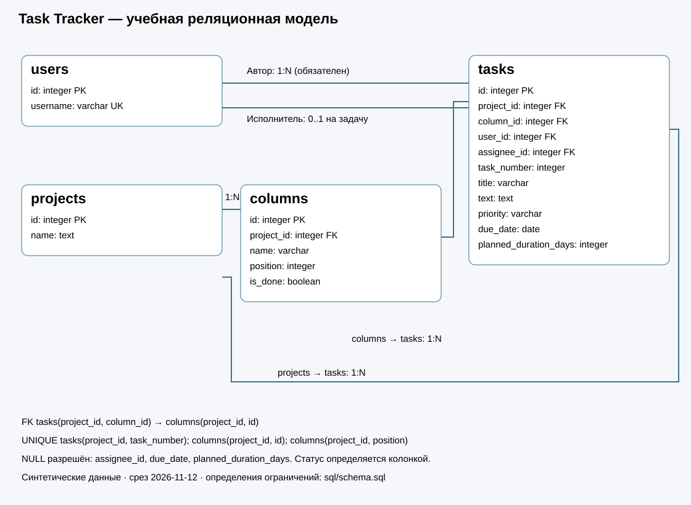
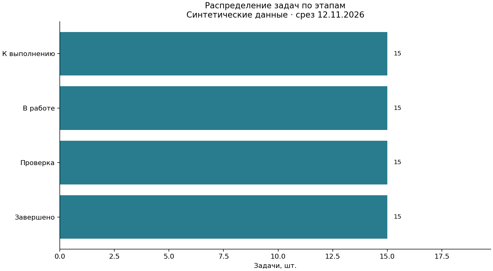
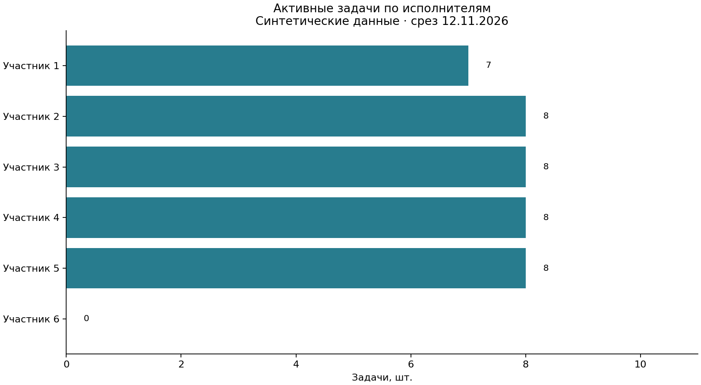
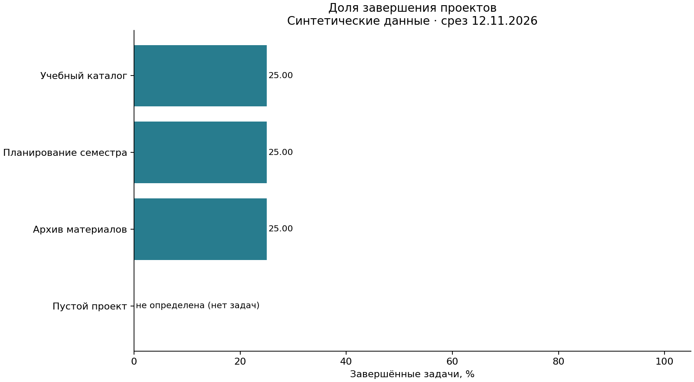

# Черновик итогового отчёта — трек A
Автор: Никитин Виктор. Группа: КультИИ АД Мод 3 1.3.

## Цель и предметная область
Разработать реляционную модель учёта задач проектов и продемонстрировать целостность,
аналитические запросы и воспроизводимое получение графиков в PostgreSQL.
Объекты: пользователи, проекты, этапы, задачи; интерфейс и авторизация в работу не входят.

## Источники и данные
Взята БД Task Tracker - дипломная работа автора, без использования фронтенд и бэкенд частей.
Все учебные данные созданы автором: 6 пользователей, 4 проекта, 16 колонок, 60 задач.
Срез 1; предусмотрены пустой проект, участник без назначений, неизвестные сроки и оценки.

## Модель и целостность

Проект содержит колонки и задачи. Каждая задача имеет автора и может иметь исполнителя.
Составной FK (project_id,column_id) запрещает размещать задачу в колонке другого проекта.
Номер уникален внутри проекта, приоритет ограничен low/medium/high.
Словарь и правила удаления: [data_dictionary.md](data_dictionary.md).
Обоснования упрощения, новая семантика due_date и длительности: [model_decisions.md](model_decisions.md).

## SQL и показатели
[queries.sql](../sql/queries.sql) отвечает на восемь вопросов:
1. Объём задач в проектах, включая пустые (LEFT JOIN, GROUP BY).
2. Распределение по этапам (LEFT JOIN).
3. Активные назначения каждого пользователя, включая нулевые (FILTER).
4. Список незавершённых просроченных задач (CTE с фиксированной датой).
5. Доля high среди всех задач проекта (NULLIF).
6. Средняя известная плановая длительность и число оценок (AVG).
7. Рейтинг долей завершения (CTE, DENSE_RANK).
8. Неназначенные задачи по проектам (NOT EXISTS, CASE, HAVING).

## Фактические результаты и проверка
Статус запуска и результаты — [validation.md](../results/validation.md).
Восемь CSV сохраняются в results/queries, версия — results/postgresql_version.txt.
Три графика — results/charts. Получено на PostgreSQL 17.5, воспроизведено на второй пустой БД:
- В проектах 1–3 по 20 задач; проект 4 пуст.
- На каждом из четырёх этапов по 15 задач: 15 завершённых и 45 активных суммарно.
- Активные назначения участников 1–6: 7, 8, 8, 8, 8, 0 задач соответственно.
- Просроченных незавершённых задач с известным сроком: 17.
- Неназначенных задач: 8; активных среди них: 6.
- Доля завершения каждого непустого проекта — 25%; общий ранг 1 демонстрирует обработку равенств DENSE_RANK.
- У пустого проекта доля и ранг отсутствуют (NULL), а не равны нулю.

Одинаковые доли обусловлены конструкцией синтетического набора. Они не доказывают равный темп работы
и не предназначены для сравнения реальных команд. Задачи без срока не включены в список известных просрочек;
их своевременность определить нельзя.

## Выводы и ограничения
Целостность задаётся ограничениями PostgreSQL, а не только проверками приложения.
Отказ от JSONB-снимка доски и дублирующего stat делает связи явными.
Пустой проект нельзя считать завершённым на 0%: доля не определена.
Неизвестные сроки не доказывают отсутствие просрочки. Число назначений не оценивает сотрудника.
Без истории изменений и дат завершения нельзя оценить скорость или своевременность выполнения.
Перед сдачей заполнить титульные сведения, согласовать формат отчёта и приложить результаты проверки.
